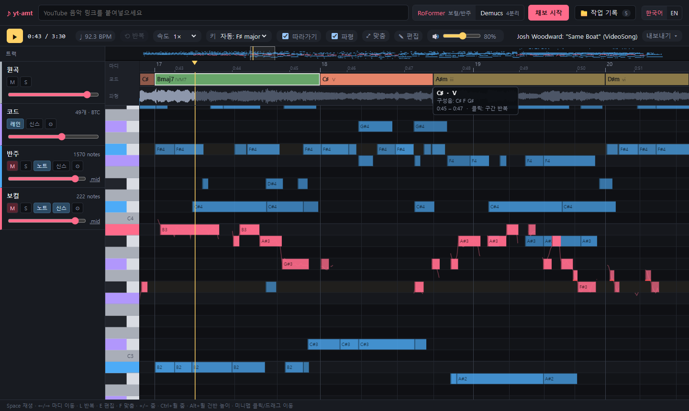
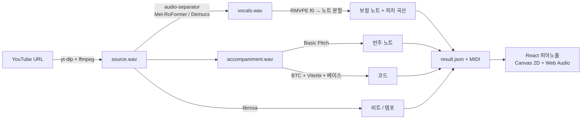

<div align="center">

# yt-amt

**YouTube 링크를 넣으면 멜로디와 코드 진행이 DAW 스타일 피아노롤에 채보됩니다.**

[English](README.md) · 한국어

[](LICENSE)


</div>

yt-amt는 로컬에서 동작하는 **자동 채보(AMT)** 웹 앱입니다. YouTube 영상의 오디오를 받아 보컬과 반주를 분리하고, 보컬 멜로디·반주·코드 진행을 채보한 뒤 피아노롤에 보여 줍니다. 피아노롤에서는 재생, 구간 반복, 느리게 듣기, 편집, 내보내기를 할 수 있습니다.

모든 처리는 내 컴퓨터에서 이루어집니다. GPU는 4GB면 충분하고, GPU가 없어도(CPU만으로도) 느리지만 동작합니다.



## 기능

- **음원 분리**: Mel-Band RoFormer(보컬/반주) 또는 Demucs `htdemucs_ft`(보컬/베이스/기타/드럼)
- **보컬 멜로디**: RMVPE 피치 추적 후 노트로 분할합니다. 비브라토와 같은 음 반복도 처리하고, 연속 피치 곡선을 노트 위에 함께 그립니다.
- **반주**: Spotify Basic Pitch 다성 채보
- **코드 진행**: BTC 트랜스포머(7화음·sus·dim·aug 등 170종)로 인식하고, 비트 단위로 평활화한 뒤 베이스 라인으로 전위(F/A)를 판정합니다. 추정한 키를 기준으로 로마 숫자와 기능별 색을 표시합니다.
- **DAW 스타일 피아노롤**: 세로 건반, 마디 룰러, 코드 레인, 파형, 미니맵, 트랙별 음소거·솔로·볼륨, 원곡 위에 채보 결과를 신스로 겹쳐 듣기
- **연습 도구**: 박자에 맞춰지는 구간 반복, 음정을 유지한 0.5×~0.9× 재생 속도, 스케일 밖 음 표시
- **편집**: 노트 이동·길이 조절·추가·삭제, 퀀타이즈, 실행 취소·다시 실행, 자동 저장. 민감도를 바꿔 트랙 하나만 수 초 만에 다시 채보
- **내보내기**: MIDI(전체 트랙과 코드 트랙), 코드 리드시트(.txt), MusicXML(멜로디와 코드 심볼, MuseScore 등에서 열림)
- **한국어·영어 UI** (브라우저 언어로 자동 선택, 전환 가능)

| 편집 모드 | 트랙별 민감도 |
|---|---|
|  |  |

## 동작 방식



백엔드는 FastAPI이고, GPU 작업은 워커 하나가 순서대로 처리합니다. 프론트엔드는 React + TypeScript(Vite)입니다. 피아노롤은 Canvas 2D 하나에 그리고, 모든 음원 트랙은 Web Audio API로 샘플 단위까지 맞춰 재생합니다.

## 빠른 시작

**필요한 것:** Python 3.9 이상([uv](https://github.com/astral-sh/uv) 설치에만 쓰이고, Python 3.11 환경은 uv가 만듭니다), Node.js 18 이상, `PATH`에 등록된 [ffmpeg](https://ffmpeg.org/download.html). CUDA 12 드라이버가 설치된 NVIDIA GPU는 선택이지만 권장합니다.

```bash
git clone https://github.com/Devleu0/yt-amt.git
cd yt-amt
```

| OS | 실행 |
|---|---|
| Windows | `run.bat` 더블클릭 |
| macOS / Linux | `./run.sh` |

처음 실행할 때 의존성을 설치하느라 몇 분 걸립니다. 그다음 백엔드(`:8000`)와 프론트엔드(`:5173`)가 켜지고 브라우저가 열립니다. 모델 가중치(전부 합쳐 약 1GB)는 각 모델을 처음 쓸 때 자동으로 받습니다.

<details>
<summary>수동 설치</summary>

```bash
# 백엔드
cd backend
python -m pip install uv
python -m uv sync                 # Python 3.11 .venv 생성
.venv/Scripts/python -m uvicorn app.main:app --port 8000   # Windows
.venv/bin/python -m uvicorn app.main:app --port 8000       # macOS / Linux

# 프론트엔드 (다른 터미널)
cd frontend
npm install
npm run dev                        # http://localhost:5173
```

</details>

**처리 속도** (RTX 3050 Laptop 4GB 기준): 3분 30초짜리 곡을 RoFormer로 처리하면 전체 약 2분 걸립니다. 코드 분석만 다시 하면 약 5초입니다. 보컬 재채보는 피치 분석 결과를 캐시해 두기 때문에 수 초면 끝납니다. macOS에서는 CPU로 동작합니다.

## 사용법

1. YouTube 링크를 붙여넣고 **RoFormer**(보컬/반주) 또는 **Demucs**(4분리)를 고른 뒤 **채보 시작**을 누릅니다.
2. 처리가 끝나면 **Space**로 재생합니다. 원곡을 음소거하고 트랙의 **신스**를 켜면 채보 결과를 들을 수 있습니다.
3. 마디 룰러를 드래그하거나 코드를 클릭하면 반복 구간이 정해집니다. **속도**를 낮춰 그 구간을 천천히 들어 보세요.
4. **E**를 누르면 편집 모드가 됩니다. 수정 내용은 자동으로 저장되고 MIDI도 다시 만들어집니다.
5. **내보내기 ▾**에서 MIDI, 리드시트, MusicXML을 받습니다. **작업 기록**에서 이전 작업을 다시 열거나, 분리된 음원을 받거나, 삭제할 수 있습니다.

| 단축키 | 동작 |
|---|---|
| `Space` / `Home` | 재생·정지 / 처음(또는 반복 시작점)으로 |
| `←` `→` | 한 마디 이동 |
| `L` / `Esc` | 반복 켜기·끄기 / 선택 또는 반복 해제 |
| `E` / `Q` | 편집 모드 / 편집 대상 트랙 퀀타이즈 |
| `Ctrl+Z` / `Ctrl+Shift+Z` | 실행 취소 / 다시 실행 |
| `Delete`, 우클릭 | 노트 삭제 (편집 모드) |
| 더블클릭 | 노트 추가 (편집 모드) |
| `F` / `+` `−` | 노트에 화면 맞춤 / 시간 확대·축소 |
| `Ctrl`+휠 / `Alt`+휠 | 시간 확대·축소 / 건반 높이 |

<details>
<summary>HTTP API</summary>

| 메서드 | 경로 | 설명 |
|---|---|---|
| `POST` | `/api/jobs` | `{url, separator: "roformer" \| "demucs"}` → 작업 |
| `GET` | `/api/jobs`, `/api/jobs/{id}` | 목록 / 상태 |
| `DELETE` | `/api/jobs/{id}` | 끝난 작업과 파일 삭제 |
| `GET` | `/api/jobs/{id}/result` | 노트, 피치 곡선, 비트, 코드 |
| `PUT` | `/api/jobs/{id}/tracks/{track}/notes` | 편집한 노트 저장 (MIDI 재생성) |
| `POST` | `/api/jobs/{id}/tracks/{track}/retranscribe` | 파라미터를 바꿔 트랙 재채보 |
| `POST` | `/api/jobs/{id}/chords` | 코드 재분석 (`change_penalty`) |
| `GET` | `/api/jobs/{id}/musicxml?track=vocals` | MusicXML 리드시트 |
| `GET` | `/api/jobs/{id}/audio?path=…&speed=0.75` | 음정을 유지한 속도 변환 오디오 |
| `GET` | `/files/{id}/…` | 분리된 음원(`stems/*.wav`), MIDI(`midi/*.mid`) |

</details>

## 문제 해결

- **다운로드 중 "Sign in to confirm"이나 JS 챌린지 오류가 날 때**: yt-dlp를 업데이트하세요(`cd backend && python -m uv lock --upgrade-package yt-dlp && python -m uv sync`). yt-dlp는 YouTube의 JS 챌린지를 풀 때 Deno를 쓰고, 없으면 Node를 씁니다.
- **CUDA 메모리 부족**: 더 짧은 곡을 쓰거나(최대 15분, `backend/app/config.py`의 `MAX_DURATION_SEC`), GPU를 쓰는 다른 프로그램을 종료하세요.
- **소리가 안 날 때**: 브라우저는 사용자가 페이지를 조작하기 전까지 오디오를 막습니다. 재생 버튼을 한 번 누르고, 🔊 마스터 볼륨과 M(음소거) 버튼을 확인하세요.
- **코드가 너무 자주 바뀌거나 반대로 둔할 때**: 코드 트랙의 ⚙에서 *코드 변경 억제* 값을 조절하세요.

## 주의 사항

이 프로젝트는 개인 학습·연구·연습용입니다. 권리가 없는 YouTube 콘텐츠를 내려받는 것은 YouTube [서비스 약관](https://www.youtube.com/t/terms)에 어긋날 수 있습니다. 저작권을 존중하고, 저작권이 있는 곡의 채보 결과를 허락 없이 배포하지 마세요. 채보는 자동으로 만들어지므로 틀린 부분이 있습니다.

## 감사의 말

[yt-dlp](https://github.com/yt-dlp/yt-dlp), [python-audio-separator](https://github.com/nomadkaraoke/python-audio-separator), [Mel-Band RoFormer 보컬 모델](https://github.com/KimberleyJensen/Mel-Band-Roformer-Vocal-Model), [Demucs](https://github.com/facebookresearch/demucs), [RMVPE](https://arxiv.org/abs/2306.15412), [Basic Pitch](https://github.com/spotify/basic-pitch), [BTC](https://github.com/jayg996/BTC-ISMIR19), [librosa](https://github.com/librosa/librosa), [music21](https://github.com/cuthbertLab/music21)을 바탕으로 만들었습니다. 라이선스는 [THIRD_PARTY_NOTICES.md](THIRD_PARTY_NOTICES.md)를 참고하세요.

데모 화면의 곡은 **[Josh Woodward](https://www.joshwoodward.com/)의 "Same Boat"**이며, [CC BY 4.0](https://creativecommons.org/licenses/by/4.0/) 라이선스입니다.

## 라이선스

[MIT](LICENSE) © 2026 Devleu
