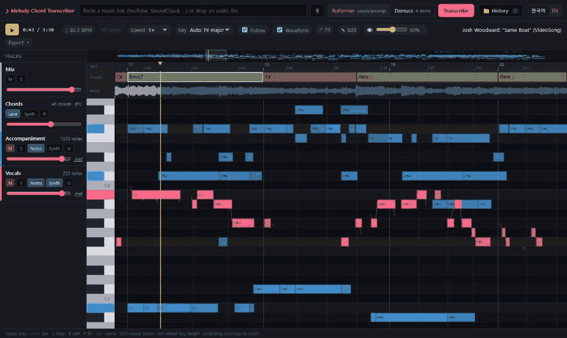
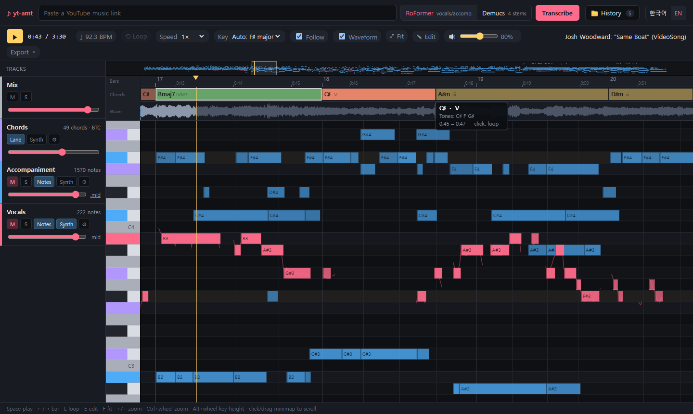
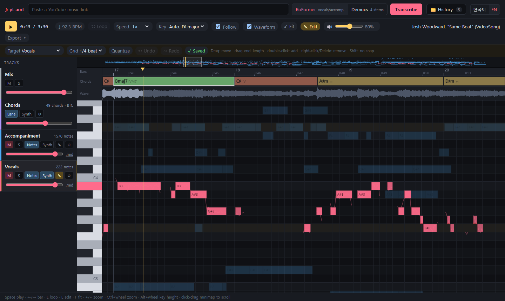
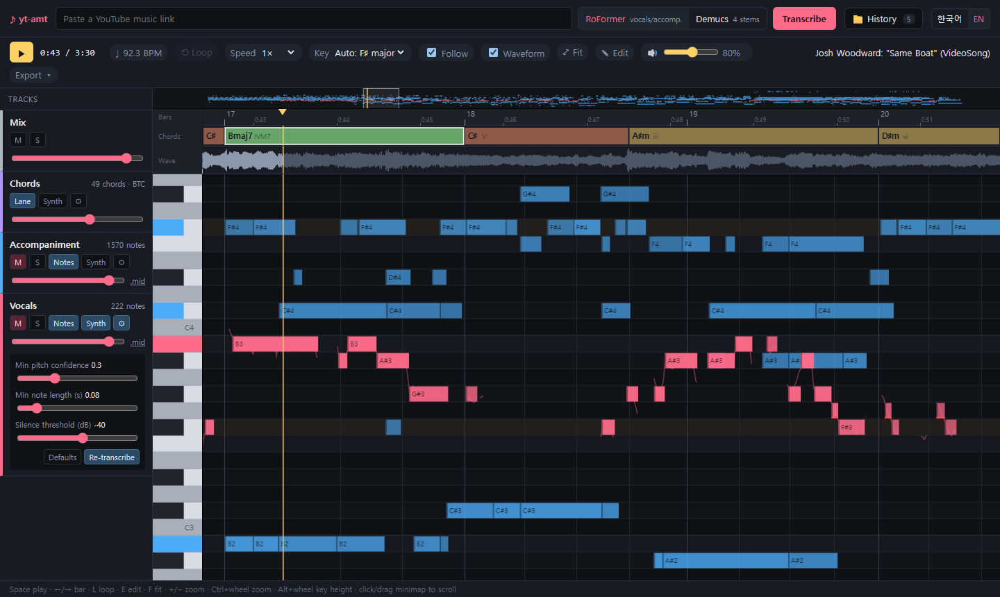
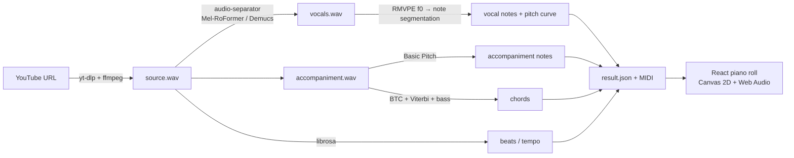
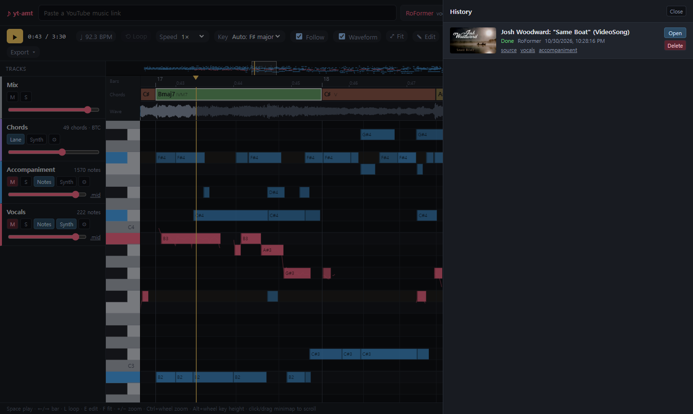

<div align="center">

# yt-amt

**Paste a YouTube link, get the melody and chords on a DAW-style piano roll.**

English · [한국어](README.ko.md)

[](LICENSE)




</div>

yt-amt is a local web app for **automatic music transcription (AMT)**. It downloads the audio of a YouTube video, separates vocals from the accompaniment, transcribes the vocal melody, the accompaniment and the chord progression, and shows everything on a piano roll you can play, loop, slow down, edit and export.

Everything runs on your machine. A 4 GB GPU is enough; CPU-only also works, just slower.



## Features

- **Source separation**: Mel-Band RoFormer (vocals / accompaniment) or Demucs `htdemucs_ft` (vocals / bass / other / drums).
- **Vocal melody**: RMVPE pitch tracking, then note segmentation that handles vibrato and repeated notes. The continuous pitch curve is drawn over the notes.
- **Accompaniment**: polyphonic transcription with Spotify's Basic Pitch.
- **Chords**: BTC transformer (170 chord classes: 7ths, sus, dim, aug…), beat-synchronous smoothing and slash chords from the bass line. Roman numerals and function colors relative to the detected key.
- **DAW-style piano roll**: vertical keyboard, bar ruler, chord lane, waveform, minimap, per-track mute / solo / volume, synth playback of the transcription on top of the original.
- **Practice tools**: beat-snapped loop regions, pitch-preserving 0.5×–0.9× speed, scale highlighting that marks out-of-key notes.
- **Editing**: move / resize / add / delete notes, quantize, undo / redo, autosave. Re-transcribe a single track with different sensitivity in seconds.
- **Export**: MIDI (all tracks + chord track), chord lead sheet (.txt), MusicXML (melody + chord symbols) for MuseScore and other notation apps.
- **UI in English and Korean** (auto-detected, switchable).

| Edit mode | Per-track sensitivity |
|---|---|
|  |  |

## How it works



The backend is FastAPI with a single GPU worker queue. The frontend is React + TypeScript (Vite). The piano roll is drawn on a single Canvas 2D element, and all stems play in sync through the Web Audio API.

## Quick start

**Requirements:** Python 3.9+ (only used to install [uv](https://github.com/astral-sh/uv), which then sets up Python 3.11), Node.js 18+, [ffmpeg](https://ffmpeg.org/download.html) on `PATH`. An NVIDIA GPU with CUDA 12 drivers is optional but recommended.

```bash
git clone https://github.com/Devleu0/yt-amt.git
cd yt-amt
```

| OS | Run |
|---|---|
| Windows | double-click `run.bat` |
| macOS / Linux | `./run.sh` |

The first run installs the dependencies, which takes a few minutes. The script then starts the backend on `:8000` and the frontend on `:5173` and opens your browser. Model weights (about 1 GB in total) download automatically the first time each model is used.

<details>
<summary>Manual setup</summary>

```bash
# backend
cd backend
python -m pip install uv
python -m uv sync                 # creates .venv with Python 3.11
.venv/Scripts/python -m uvicorn app.main:app --port 8000   # Windows
.venv/bin/python -m uvicorn app.main:app --port 8000       # macOS / Linux

# frontend (another terminal)
cd frontend
npm install
npm run dev                        # http://localhost:5173
```

</details>

**Performance** (RTX 3050 Laptop, 4 GB): a 3:30 song takes about 2 minutes end to end with RoFormer. Re-running chord analysis takes about 5 s. Re-transcribing the vocals takes a few seconds, because the pitch analysis is cached. On macOS the models run on the CPU.

## Usage

1. Paste a YouTube link, choose **RoFormer** (vocals + accompaniment) or **Demucs** (4 stems), and press **Transcribe**.
2. When it finishes, press **Space** to play. Mute the mix and turn on a track's **Synth** to hear the transcription.
3. Drag on the bar ruler, or click a chord, to set a loop. Use **Speed** to slow the loop down.
4. Press **E** to edit. Changes save automatically and the MIDI files are regenerated.
5. Use **Export ▾** for MIDI, the lead sheet or MusicXML. Use **History** to reopen, download stems from, or delete past jobs.



| Shortcut | Action |
|---|---|
| `Space` / `Home` | play-pause / jump to start (or loop start) |
| `←` `→` | move one bar |
| `L` / `Esc` | toggle loop / clear selection or loop |
| `E` / `Q` | edit mode / quantize target track |
| `Ctrl+Z` / `Ctrl+Shift+Z` | undo / redo |
| `Delete`, right-click | delete note (edit mode) |
| double-click | add a note (edit mode) |
| `F` / `+` `−` | fit to notes / zoom time |
| `Ctrl` + wheel / `Alt` + wheel | zoom time / key height |

<details>
<summary>HTTP API</summary>

| Method | Path | Description |
|---|---|---|
| `POST` | `/api/jobs` | `{url, separator: "roformer" \| "demucs"}` → job |
| `GET` | `/api/jobs`, `/api/jobs/{id}` | list / status |
| `DELETE` | `/api/jobs/{id}` | delete a finished job and its files |
| `GET` | `/api/jobs/{id}/result` | notes, pitch curve, beats, chords |
| `PUT` | `/api/jobs/{id}/tracks/{track}/notes` | save edited notes (regenerates MIDI) |
| `POST` | `/api/jobs/{id}/tracks/{track}/retranscribe` | re-run one track with new parameters |
| `POST` | `/api/jobs/{id}/chords` | re-run chord analysis (`change_penalty`) |
| `GET` | `/api/jobs/{id}/musicxml?track=vocals` | MusicXML lead sheet |
| `GET` | `/api/jobs/{id}/audio?path=…&speed=0.75` | pitch-preserving time-stretched audio |
| `GET` | `/files/{id}/…` | stems (`stems/*.wav`) and MIDI (`midi/*.mid`) |

</details>

## Project layout

```
backend/app/
  main.py            FastAPI routes
  jobs.py            job queue, result editing, MIDI regeneration
  pipeline/          download · separate · rmvpe · vocal · accomp · chords · export
  pipeline/btc/      vendored BTC model (MIT)
frontend/src/
  App.tsx            transport, mixer state, editing, shortcuts
  components/        PianoRoll (canvas), TrackPanel, HistoryPanel
  audio/engine.ts    synced multi-stem playback, loop, speed, synth
  music/             key detection, chord naming, beat grid
  i18n.tsx           English / Korean strings
```

## Troubleshooting

- **Download fails with "Sign in to confirm" or a JS challenge error**: update yt-dlp (`cd backend && python -m uv lock --upgrade-package yt-dlp && python -m uv sync`). yt-dlp uses Deno, or Node as a fallback, to solve YouTube's JS challenges.
- **CUDA out of memory**: use shorter songs (the limit is 15 minutes, set by `MAX_DURATION_SEC` in `backend/app/config.py`), or close other GPU applications.
- **No sound**: the browser blocks audio until you interact with the page, so press Play once. Check the 🔊 master volume and the mute (M) buttons.
- **Chords look busy or sluggish**: open ⚙ on the Chords track and change the *chord change penalty*.

## Disclaimer

This project is for personal study, research and practice. Downloading content from YouTube may violate its [Terms of Service](https://www.youtube.com/t/terms) unless you have the right to do so. Respect copyright, and do not redistribute transcriptions of copyrighted music without permission. Transcriptions are automatic and will contain mistakes.

## Acknowledgements

Built on [yt-dlp](https://github.com/yt-dlp/yt-dlp), [python-audio-separator](https://github.com/nomadkaraoke/python-audio-separator), [Mel-Band RoFormer vocal model](https://github.com/KimberleyJensen/Mel-Band-Roformer-Vocal-Model), [Demucs](https://github.com/facebookresearch/demucs), [RMVPE](https://arxiv.org/abs/2306.15412), [Basic Pitch](https://github.com/spotify/basic-pitch), [BTC](https://github.com/jayg996/BTC-ISMIR19), [librosa](https://github.com/librosa/librosa) and [music21](https://github.com/cuthbertLab/music21). See [THIRD_PARTY_NOTICES.md](THIRD_PARTY_NOTICES.md) for licenses.

The demo shows **"Same Boat" by [Josh Woodward](https://www.joshwoodward.com/)**, licensed under [CC BY 4.0](https://creativecommons.org/licenses/by/4.0/).

## License

[MIT](LICENSE) © 2026 Devleu
